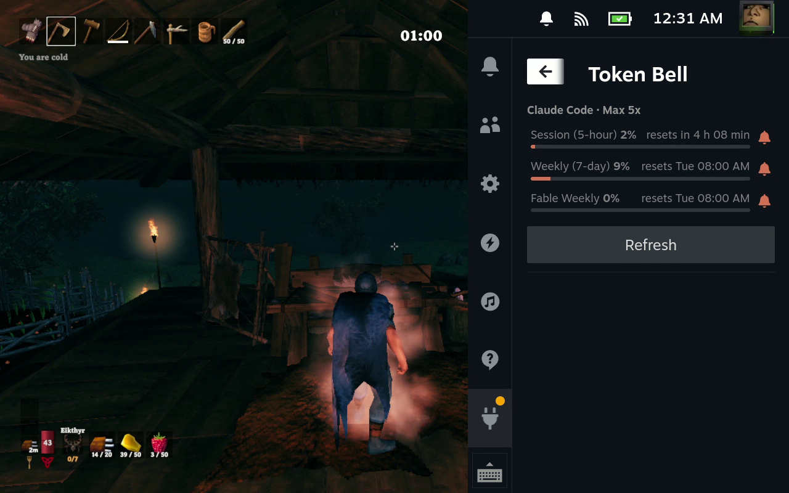

# Token Bell

A [Decky Loader](https://decky.xyz) plugin for the Steam Deck: your Claude plan limits in the
Quick Access Menu, and a ping in game when a limit resets.



Max out your session, go play something, and get a Steam notification over the game when the
session is back.

- **Limits:** session (5-hour), weekly and per-model weekly, each with a bar and the time to reset.
  They are account-wide, so usage on other machines counts.
- **Bells:** press A on a limit to turn its bell on or off. A limit with its bell on gives a
  notification with sound when it resets, if it was used at all.
- **Sign in:** uses the Claude Code login on the Deck. Without one, "Sign in to Claude" installs
  Claude Code with Anthropic's installer and runs its `claude auth login`: sign in in Steam's
  browser and it finishes by itself, or scan the QR code with a phone and type in the code it shows.

## How it works

`main.py` runs the Claude usage counter in `vendor/claude-usage` every five
minutes and when a reset is due, and sends the result to the panel (`src/index.tsx`). The reset
time is known in advance, so the ping doesn't need the network at that moment.

## Credit

The numbers come from [`omarchy-agent-usage-claude`](https://github.com/basecamp/omarchy/blob/master/bin/omarchy-agent-usage-claude),
the Claude usage counter this plugin was forked from, included unchanged under its MIT licence
(`vendor/claude-usage`).

## Build and install

```sh
npm install
tools/package.sh          # builds and packs out/token-bell.zip
node tools/install.mjs    # asks Decky to install it; confirm the prompt in the Steam UI
```

`tools/install.mjs` talks to Steam's debug port (localhost:8080), which needs Decky's developer
mode. The zip can also be installed from Decky's settings (Developer > Install plugin from ZIP).

## Known gaps

- A Claude login is only renewed when Claude Code itself runs. If it never runs, the limits pause
  after about eight hours and the ping falls back to the last known reset time.
- A complete sign-in through the panel has not been tested yet, only its start and a rejected code.
- The usage endpoint the collector reads is not a documented API and may change.
